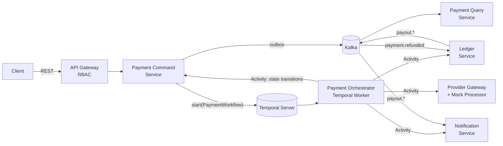

# PayFlow — Architecture & Phased Implementation Plan

**Status:** Draft v0.2 · **Scope:** Backend only (console UI, BRD, SRS already finalized at v0.2) · **Author:** G.M. Hossen · **Date:** 2026-10-18

> This document is the execution contract for building PayFlow's backend. It assumes the BRD v0.2 and SRS v0.2 as the source of business/functional truth and translates them into a concrete, buildable system. No production code lives here — only schemas, contracts, and the order of work.

## Table of contents

1. [Architectural foundation & tech decisions](#1-architectural-foundation--tech-decisions)
2. [High-level blueprint](#2-high-level-blueprint)
3. [Roadmap — vertical slices](#3-roadmap--vertical-slices-tracer-bullet-architecture)
   - [Milestone 0 — Infrastructure & skeleton](#milestone-0--infrastructure--skeleton)
   - [Milestone 0.5 — CQRS & DDD core harness](#milestone-05--cqrs--ddd-core-harness)
   - [Milestone 1 — The golden path](#milestone-1--the-golden-path-end-to-end-vertical-slice)
   - [Milestone 2 — Resiliency & failure flows](#milestone-2--resiliency--failure-flows)
   - [Milestone 3 — Payout & refund lifecycles](#milestone-3--payout--refund-lifecycles)
   - [Milestone 4 — Security, RBAC & observability](#milestone-4--security-rbac--observability)
4. [Testing strategy](#4-testing-strategy)
5. [Deferred / v2 backlog](#5-deferred--v2-backlog)

---

## 1. Architectural foundation & tech decisions

### 1.1 Stack

| Concern | Choice | Why |
|---|---|---|
| Language / runtime | **Java 25 (LTS)**, virtual threads used throughout the I/O-bound service layer | Latest LTS; virtual threads remove the need to hand-tune thread pools for the many blocking calls this system makes (JDBC, outbound REST to the provider/ledger/notification internal APIs, Temporal activity execution) |
| Framework | **Spring Boot 3.4+ / 4.x line** — whichever is the latest release with first-class Java 25 support at build time | Standard for the roles this project targets; the 4.x line is adopted as soon as it's GA-stable, not pinned ahead of that |
| Write-side store | **PostgreSQL 16+** | ACID, `JSONB` for event payloads, native `CHECK` constraints |
| Cache / coordination | **Redis 7.4+** | Idempotency-key store (BR-2), short-lived distributed locks (payout sweep, outbox poller leader election) |
| Event backbone | **Apache Kafka 3.9+, KRaft mode** (no ZooKeeper) | Lighter local footprint, matches modern Kafka deployment (ZK is EOL-track) |
| Orchestration engine | **Temporal (official Java SDK)** | Durable execution engine for the payment saga — replaces a hand-rolled, Kafka-choreographed state machine with built-in retries, timers, and a queryable workflow history that doubles as the operator's saga audit trail (BR-14). See §1.2. |
| Build | Gradle, multi-module | One root build, one module per service, one `payflow-common` module for shared event/DTO contracts |

### 1.2 Core reliability patterns

These five patterns are the backbone of every milestone below — they are built once, early, and reused everywhere rather than bolted on per-service.

#### Transactional Outbox (dual-write protection)

A service never calls Kafka directly from request-handling code. Writing the domain row and the `outbox_events` row happens in **one JDBC transaction**; a separate poller (or Debezium-style log-tailer, see §2.2) reads unpublished outbox rows and publishes them to Kafka, then marks them published. This removes the classic failure mode: *DB commit succeeds, Kafka publish fails (or vice versa), and the two stores disagree forever.*

```mermaid
sequenceDiagram
    participant API as Payment Command API
    participant DB as Postgres (payments + outbox_events)
    participant Poller as Outbox Poller
    participant K as Kafka

    API->>DB: BEGIN; INSERT payments; INSERT outbox_events; COMMIT
    loop every 200ms
        Poller->>DB: SELECT * FROM outbox_events WHERE published_at IS NULL FOR UPDATE SKIP LOCKED
        Poller->>K: publish(event)
        Poller->>DB: UPDATE outbox_events SET published_at = now()
    end
```

#### Orchestration-based saga via Temporal (replaces hand-rolled Kafka choreography)

The payment lifecycle — **`authorizeAndCapture → postToLedger → dispatchWebhook`** — is a single **Temporal Workflow** (`PaymentWorkflow`), not a chain of services reacting to each other's Kafka events. The **Payment Command Service** is a Temporal *client*: immediately after it commits the payment row + outbox event in one transaction, it also starts `PaymentWorkflow`, using the payment's own ID as the Temporal Workflow ID — Temporal itself then guarantees the workflow starts exactly once, even if the start call is retried. The **Payment Orchestrator** stops being a REST/Kafka service and becomes a **Temporal Worker**: a long-running process that polls a Temporal Task Queue and executes the workflow's code and its activities.

Each step of the workflow is an **Activity** — a synchronous call out to the service that owns that piece of state, with Temporal transparently handling retries, backoff, and timeouts around the call:

| Activity | Calls | On success | On failure (after Temporal's retry policy is exhausted) |
|---|---|---|---|
| `authorizeAndCapture` | Provider Gateway (`/internal/authorize`), then Payment Command (`authorize()`/`capture()`) | → `postToLedger` | Workflow branches to **`markPaymentFailed`** — nothing was captured, so nothing needs reversing |
| `postToLedger` | Ledger Service, new endpoint `POST /internal/ledger/post-capture` (synchronous — this is what lets the workflow *see* a ledger failure immediately, instead of waiting on an async `ledger.failed` event) | → `dispatchWebhook` | Workflow branches to **`reverseProviderCharge`** (compensation) |
| `dispatchWebhook` | Notification Service, new endpoint `POST /internal/webhooks/dispatch` (enqueues the delivery; Notification Service's own backoff/DLQ machinery, unchanged from Milestone 1, handles the actual HTTP attempts to the merchant) | workflow completes | — (notification failure never rolls back a successful payment) |

**Compensation activities (BR-5, surfaced to the operator per BR-14):**

- **`reverseProviderCharge`** — voids/refunds the charge at the (mock) provider, then calls Payment Command's existing `refund()` command. That command already publishes `payment.refunded` via the outbox exactly as the merchant-initiated refund path does (BR-16, Milestone 3) — so Ledger Service's *existing* Kafka consumer posts the reversing entry with no new code path. Reusing BR-16's machinery for the saga's own rollback is deliberate: one reversal mechanism, not two.
- **`markPaymentFailed`** — marks the payment `FAILED` with its decline reason. No provider or ledger reversal is needed, because this branch is only reached when authorization itself was declined — nothing was ever captured.

```mermaid
sequenceDiagram
    participant Cmd as Payment Command<br/>(Temporal client)
    participant WF as PaymentWorkflow<br/>(Temporal Worker)
    participant Prov as Provider Gateway
    participant Ldg as Ledger Service
    participant Notif as Notification Service

    Cmd->>WF: start(paymentId)  [workflowId = paymentId]
    WF->>Prov: Activity: authorizeAndCapture()
    alt declined
        WF->>Cmd: Activity: markPaymentFailed()
        WF->>Notif: Activity: dispatchWebhook("payment.failed")
    else approved
        WF->>Ldg: Activity: postToLedger()  [POST /internal/ledger/post-capture]
        alt ledger post fails
            WF->>Prov: Activity: reverseProviderCharge()
            WF->>Cmd: (reverseProviderCharge calls) refund()
            Note over Cmd,Ldg: outbox publishes payment.refunded;<br/>Ledger's existing Kafka consumer posts the reversal
            WF->>Notif: Activity: dispatchWebhook("payment.refunded")
        else ledger post succeeds
            WF->>Notif: Activity: dispatchWebhook("payment.captured")
        end
    end
```

Why this replaces the original Kafka-driven design: the hand-rolled version needed the Orchestrator to consume `payment.created`, call out synchronously, then *separately* consume a `ledger.failed` event to find out — asynchronously, after the fact — that it needed to compensate. Temporal collapses that into one deterministic function: a failed Activity call throws, the workflow's own `try/catch` runs the compensation, and the **entire execution history (every attempt, every retry, every compensation) is durably recorded and queryable** — which is exactly what BR-14's operator saga feed needs, for free, instead of a bespoke `saga_events` table (see Milestone 4). The `ledger.failed` Kafka topic from the original design is retired; Ledger Service keeps publishing `payout.*` events (Milestone 3, unaffected) and keeps consuming `payment.refunded` (now serving both BR-16 and saga compensation).

#### Consumer idempotency / deduplication

Kafka gives **at-least-once** delivery — every consumer must assume it can see the same event twice (rebalance, consumer crash-and-resume, poller retry). Every consumer service owns a `processed_events` table keyed on `(event_id, consumer_name)`. Before acting on a message, the consumer attempts `INSERT ... ON CONFLICT DO NOTHING`; zero rows affected means "already handled," and the handler short-circuits without re-applying side effects (no double ledger posting, no duplicate webhook).

#### Webhook resilience (exponential backoff + DLQ)

`webhook_deliveries` rows move `PENDING → DELIVERED` on a 2xx response, or accumulate `attempt_count` with `next_retry_at = now() + backoff(attempt_count)` on failure. Backoff schedule: `1s, 5s, 30s, 2m, 10m` (5 attempts), after which the row moves to `DEAD_LETTER` for operator triage (Milestone 4).

#### Deterministic mock provider (magic numbers)

The Provider Gateway Service never calls a real network — it pattern-matches on the **last 4 digits of the test card number** supplied in the request, so every test and every demo is 100% reproducible:

| Card (last 4) | Behavior | Simulated latency |
|---|---|---|
| `4242` | Approved | 150–300ms |
| `0002` | Declined — insufficient funds | 150–300ms |
| `0069` | Declined — card expired | 150–300ms |
| `0119` | Processor **timeout** (no response — exercises retry/circuit-breaker paths) | 5s, then drops |
| `0127` | Declined — generic/do-not-honor | 150–300ms |

This single table is what makes every failure-path requirement (BR-5 saga compensation, webhook retry, outbox recovery) deterministically testable with a `curl` one-liner instead of flaky chaos engineering.

---

## 2. High-level blueprint

### 2.1 Service topology

| Service | Port | Responsibility | REST (owns) | Kafka produces | Kafka consumes |
|---|---|---|---|---|---|
| **API Gateway** | 8080 | Routing, JWT Access/Refresh Token Service, RBAC check (`ROLE_MERCHANT`/`ROLE_OPERATOR`), rate limit | `POST /auth/token`, `POST /auth/refresh`, `POST /auth/revoke` | — | — |
| **Payment Command Service** | 8081 | Owns `Payment` aggregate; sole writer of payment state; **Temporal client** — starts `PaymentWorkflow` after each new payment commits | `POST /payments`, `POST /payments/{id}/refund`, internal `authorize()`/`capture()`/`fail()`/`refund()` (called by workflow Activities) | `payment.created`, `payment.authorized`, `payment.failed`, `payment.captured`, `payment.refunded` | *(commands only, no consume)* |
| **Payment Query Service** | 8082 | Denormalized read model | `GET /payments/{id}`, `GET /payments` | — | `payment.*` |
| **Provider Gateway Service** | 8083 | Anti-corruption layer to mock provider(s) | `POST /internal/authorize`, `POST /internal/void` (both sync, called by Temporal Activities) | — | — |
| **Payment Orchestrator** | 8084 (worker — no public port) | **Temporal Worker**: hosts `PaymentWorkflow` and its activities (`authorizeAndCapture`, `postToLedger`, `dispatchWebhook`, `reverseProviderCharge`, `markPaymentFailed`) | — (polls Temporal Task Queue, no REST surface) | — | — *(driven by Temporal, not Kafka)* |
| **Ledger Service** | 8085 | Double-entry bookkeeping, payout state machine | `GET /accounts/{id}/balance`, `GET /ledger`, `POST /payouts`, `GET /operator/ledger/integrity`, new internal `POST /internal/ledger/post-capture` (sync, called by the `postToLedger` Activity) | `payout.requested`, `payout.settled`, `payout.failed` | `payment.refunded` (serves both BR-16 merchant refunds and saga compensation) |
| **Notification Service** | 8086 | Webhook delivery + retry/DLQ | `GET /operator/webhooks/dlq`, new internal `POST /internal/webhooks/dispatch` (sync, called by the `dispatchWebhook` Activity) | — | `payout.*` (payment outcomes now arrive via the `dispatchWebhook` Activity, not Kafka) |

> **Temporal Server** (port 7233) and **Temporal UI** (port 8088) are new pieces of local infrastructure, not application services — see Milestone 0.



### 2.2 Database schemas (DDL)

Database-per-service: three logical Postgres databases (`payment_db`, `ledger_db`, `webhook_db`), each owned exclusively by its service.

#### `payment_db`

```sql
CREATE TABLE payments (
    id               UUID PRIMARY KEY DEFAULT gen_random_uuid(),
    merchant_id      UUID NOT NULL,
    customer_name    VARCHAR(255) NOT NULL,
    amount_minor     BIGINT NOT NULL CHECK (amount_minor > 0),
    currency         CHAR(3) NOT NULL DEFAULT 'USD',
    status           VARCHAR(20) NOT NULL
                       CHECK (status IN ('CREATED','AUTHORIZED','CAPTURED','FAILED','REFUNDED')),
    provider         VARCHAR(50),
    payment_method   VARCHAR(50),
    idempotency_key  VARCHAR(100) NOT NULL,
    decline_reason   VARCHAR(255),
    created_at       TIMESTAMPTZ NOT NULL DEFAULT now(),
    updated_at       TIMESTAMPTZ NOT NULL DEFAULT now(),
    UNIQUE (merchant_id, idempotency_key)
);
CREATE INDEX idx_payments_merchant_status ON payments (merchant_id, status);

CREATE TABLE outbox_events (
    id               UUID PRIMARY KEY DEFAULT gen_random_uuid(),
    aggregate_type   VARCHAR(50) NOT NULL,       -- e.g. 'PAYMENT'
    aggregate_id     UUID NOT NULL,
    event_type       VARCHAR(50) NOT NULL,       -- e.g. 'payment.captured'
    payload          JSONB NOT NULL,
    created_at       TIMESTAMPTZ NOT NULL DEFAULT now(),
    published_at     TIMESTAMPTZ                 -- NULL = not yet published
);
CREATE INDEX idx_outbox_unpublished ON outbox_events (created_at) WHERE published_at IS NULL;
```

#### `ledger_db`

```sql
CREATE TABLE ledger_accounts (
    id               UUID PRIMARY KEY DEFAULT gen_random_uuid(),
    merchant_id      UUID,                       -- NULL for platform-level accounts
    account_type     VARCHAR(20) NOT NULL
                       CHECK (account_type IN ('ASSET','LIABILITY','EQUITY','REVENUE','EXPENSE')),
    account_name     VARCHAR(100) NOT NULL,       -- 'Platform Bank', 'Merchant Payable', ...
    normal_balance   VARCHAR(10) NOT NULL CHECK (normal_balance IN ('DEBIT','CREDIT')),
    balance_minor    BIGINT NOT NULL DEFAULT 0,
    UNIQUE (merchant_id, account_name)
);

CREATE TABLE ledger_entries (
    id                UUID PRIMARY KEY DEFAULT gen_random_uuid(),
    transaction_ref   VARCHAR(100) NOT NULL,      -- payment id or payout id
    debit_account_id  UUID NOT NULL REFERENCES ledger_accounts(id),
    credit_account_id UUID NOT NULL REFERENCES ledger_accounts(id),
    amount_minor      BIGINT NOT NULL CHECK (amount_minor > 0),
    posted_at         TIMESTAMPTZ NOT NULL DEFAULT now(),
    CHECK (debit_account_id <> credit_account_id)
);
CREATE INDEX idx_ledger_entries_ref ON ledger_entries (transaction_ref);

-- Consumer-side idempotency (shared pattern, one table per consuming service)
CREATE TABLE processed_events (
    event_id       UUID NOT NULL,
    consumer_name  VARCHAR(50) NOT NULL,
    processed_at   TIMESTAMPTZ NOT NULL DEFAULT now(),
    PRIMARY KEY (event_id, consumer_name)
);
```

> **On the "debits = credits" constraint:** a single `ledger_entries` row is balanced *by construction* — one debit leg, one credit leg, same `amount_minor` — so there's nothing to check within a row. The invariant that matters is **global**: `SUM(debits across the ledger) = SUM(credits across the ledger)`, and that's a cross-row aggregate a SQL `CHECK` constraint cannot express. That's exactly what `GET /operator/ledger/integrity` (BR-12, Milestone 4) computes and re-verifies continuously — the real guarantee lives in a query, not a constraint.

#### `webhook_db`

```sql
CREATE TABLE webhook_endpoints (
    id               UUID PRIMARY KEY DEFAULT gen_random_uuid(),
    merchant_id      UUID NOT NULL,
    url              VARCHAR(500) NOT NULL,
    signing_secret   VARCHAR(100) NOT NULL,
    active           BOOLEAN NOT NULL DEFAULT true
);

CREATE TABLE webhook_deliveries (
    id               UUID PRIMARY KEY DEFAULT gen_random_uuid(),
    endpoint_id      UUID NOT NULL REFERENCES webhook_endpoints(id),
    event_type       VARCHAR(50) NOT NULL,
    payload          JSONB NOT NULL,
    status           VARCHAR(20) NOT NULL DEFAULT 'PENDING'
                       CHECK (status IN ('PENDING','DELIVERED','FAILED','DEAD_LETTER')),
    attempt_count    INT NOT NULL DEFAULT 0,
    response_code    INT,
    last_attempt_at  TIMESTAMPTZ,
    next_retry_at    TIMESTAMPTZ
);
CREATE INDEX idx_webhook_due ON webhook_deliveries (next_retry_at) WHERE status = 'PENDING';
```

### 2.3 Ledger topology & exact postings

Chart of accounts (schema supports all five standard types; v1 only posts to Asset/Liability/Revenue — Equity and Expense exist in the `account_type` enum for v2, e.g. retained earnings or processor cost-of-goods, but no v1 flow writes to them):

| Account | Type | Normal balance | Scope |
|---|---|---|---|
| Provider Settlement | Asset | Debit | Platform-level |
| Platform Bank | Asset | Debit | Platform-level |
| Platform Fee Revenue | Revenue | Credit | Platform-level |
| Merchant Payable | Liability | Credit | Per-merchant |
| Payout In-Transit | Liability | Credit | Per-merchant |

#### 1. Payment capture ($100.00 charge, 2.9% fee = $2.90)

| Debit | Credit | Amount |
|---|---|---|
| Platform Bank | Merchant Payable | $97.10 |
| Platform Bank | Platform Fee Revenue | $2.90 |

*(Two `ledger_entries` rows, both `transaction_ref = payment.id`, posted in one DB transaction inside Ledger Service's `POST /internal/ledger/post-capture` — called synchronously by the Temporal workflow's `postToLedger` Activity, §1.2, so a posting failure is visible to the workflow immediately rather than via a later async event.)*

#### 2. Full refund (reversing the above)

| Debit | Credit | Amount |
|---|---|---|
| Merchant Payable | Platform Bank | $97.10 |
| Platform Fee Revenue | Platform Bank | $2.90 |

#### 3. Payout to bank (two-phase — BR-15)

**Phase A — payout requested** (`POST /payouts`, manual or EOD sweep):

| Debit | Credit | Amount |
|---|---|---|
| Merchant Payable | Payout In-Transit | full available balance |

**Phase B — payout settled** (mocked bank confirmation, Milestone 3):

| Debit | Credit | Amount |
|---|---|---|
| Payout In-Transit | Platform Bank | same amount |

---

## 3. Roadmap — vertical slices (Tracer Bullet architecture)

Each milestone is a **complete, runnable, demoable slice** through every layer the slice touches — never "finish all of Service X" before starting Service Y. By the end of Milestone 1 a `curl` call produces a real charge, a real ledger entry, and a real webhook, even though every service is still minimal.

### Milestone 0 — Infrastructure & skeleton

**Objective:** everything boots, nothing does anything yet.

**Tasks**

1. Create the Gradle multi-module root:
   ```
   payflow/
     settings.gradle.kts
     common-cqrs/                 # framework-agnostic DDD/CQRS harness — see Milestone 0.5; every service module depends on it
     payflow-common/              # shared Kafka event DTOs, error types (depends on common-cqrs for DomainEvent)
     payflow-api-gateway/
     payflow-payment-command-service/
     payflow-payment-query-service/
     payflow-provider-gateway-service/
     payflow-payment-orchestrator/   # Temporal Worker: depends on temporal-sdk + temporal-testing (test scope)
     payflow-ledger-service/
     payflow-notification-service/
   ```
2. Write `docker-compose.yml` for infra only (app services run locally during development):
   ```yaml
   version: "3.9"
   services:
     postgres:
       image: postgres:16-alpine
       environment:
         POSTGRES_USER: payflow
         POSTGRES_PASSWORD: payflow
         POSTGRES_MULTIPLE_DATABASES: payment_db,ledger_db,webhook_db
       ports: ["5432:5432"]
       volumes:
         - ./infra/postgres-init:/docker-entrypoint-initdb.d
       deploy:
         resources:
           limits: { memory: 256m }

     redis:
       image: redis:7.4-alpine
       ports: ["6379:6379"]
       deploy:
         resources:
           limits: { memory: 128m }

     kafka:
       image: apache/kafka:3.9.0
       ports: ["9092:9092"]
       environment:
         KAFKA_NODE_ID: 1
         KAFKA_PROCESS_ROLES: broker,controller
         KAFKA_LISTENERS: PLAINTEXT://:9092,CONTROLLER://:9093
         KAFKA_ADVERTISED_LISTENERS: PLAINTEXT://localhost:9092
         KAFKA_CONTROLLER_LISTENER_NAMES: CONTROLLER
         KAFKA_CONTROLLER_QUORUM_VOTERS: 1@kafka:9093
         KAFKA_HEAP_OPTS: "-Xmx256m -Xms256m"
       deploy:
         resources:
           limits: { memory: 384m }

     temporal:
       image: temporalio/auto-setup:1.24
       environment:
         - DB=postgres12
         - DB_PORT=5432
         - POSTGRES_USER=payflow
         - POSTGRES_PWD=payflow
         - POSTGRES_SEEDS=postgres
       ports: ["7233:7233"]
       depends_on: [postgres]
       deploy:
         resources:
           limits: { memory: 256m }

     temporal-ui:
       image: temporalio/ui:2.31.2
       environment:
         - TEMPORAL_ADDRESS=temporal:7233
         - TEMPORAL_CORS_ORIGINS=http://localhost:3000
       ports: ["8088:8080"]
       depends_on: [temporal]
       deploy:
         resources:
           limits: { memory: 128m }
   ```
3. Add a `postgres-init` script that creates the three application databases from `POSTGRES_MULTIPLE_DATABASES` (`temporal`'s own schema is managed separately by `auto-setup` on first boot, against the same Postgres instance).
4. Each service: bare Spring Boot app, `/actuator/health` enabled, `application.yml` pointed at its own database/Kafka bootstrap; `payflow-payment-orchestrator` additionally points its `WorkflowServiceStubs` at `temporal:7233`.
5. Set `JAVA_TOOL_OPTIONS=-Xmx256m` per service in local run config (mirrors future container limits).

**Verification**

```bash
docker compose up -d
docker compose ps                     # all healthy
curl -s localhost:5432                # (expect connection reset, not "no route" — confirms port is up)
curl -s localhost:8081/actuator/health | jq .status   # "UP", once each service is scaffolded
curl -s -o /dev/null -w "%{http_code}\n" localhost:8088   # 200 — Temporal Web UI is reachable
```

### Milestone 0.5 — CQRS & DDD core harness

**Objective:** before any service writes a line of payment logic, the architectural skeleton every service will build on — aggregates, events, repositories, command/query dispatch — exists as a standalone, framework-agnostic library module (`:common-cqrs`), fully unit-tested against a throwaway toy aggregate, never against a real PayFlow domain type. This milestone produces **zero business behavior**; it produces the contracts that make `AGENT_AND_DEV_GUIDELINES.md`'s rules mechanically enforceable from Milestone 1 onward.

This is deliberately sequenced *before* Milestone 1: writing the Payment aggregate against a harness that doesn't exist yet invites every service to improvise its own ad hoc version of "repository" and "event," which is exactly the inconsistency this milestone exists to prevent.

#### 1. Core DDD building blocks

```java
// common-cqrs/src/main/java/dev/payflow/cqrs/domain/EventMetadata.java
package dev.payflow.cqrs.domain;

import java.time.Instant;
import java.util.UUID;

/** Tracing metadata every domain event carries, independent of its own payload. */
public record EventMetadata(
    UUID eventId,
    Instant occurredOn,
    UUID correlationId,
    UUID causationId,          // nullable: null for the first event in a chain
    Object aggregateId
) {
    public static EventMetadata next(Object aggregateId, UUID correlationId, UUID causationId) {
        return new EventMetadata(UUID.randomUUID(), Instant.now(), correlationId, causationId, aggregateId);
    }
}
```

```java
// common-cqrs/src/main/java/dev/payflow/cqrs/domain/DomainEvent.java
package dev.payflow.cqrs.domain;

import java.time.Instant;
import java.util.UUID;

/**
 * Every domain event is a record that implements this interface and carries an
 * {@link EventMetadata} component — composition, not inheritance, so records stay records.
 */
public interface DomainEvent {
    EventMetadata metadata();

    default UUID eventId()        { return metadata().eventId(); }
    default Instant occurredOn()  { return metadata().occurredOn(); }
    default UUID correlationId()  { return metadata().correlationId(); }
    default UUID causationId()    { return metadata().causationId(); }
    default Object aggregateId()  { return metadata().aggregateId(); }
}
```

```java
// common-cqrs/src/main/java/dev/payflow/cqrs/domain/ValueObject.java
package dev.payflow.cqrs.domain;

/**
 * Marker interface for immutable, structurally-equal domain values.
 * Implement with a {@code record} — records already give you the equality and
 * immutability a value object needs; this interface exists so the type system
 * (and ArchUnit, see AGENT_AND_DEV_GUIDELINES.md) can distinguish value objects
 * from entities at compile time and in architecture tests.
 *
 * e.g. {@code public record Money(long amountMinor, Currency currency) implements ValueObject {}}
 */
public interface ValueObject {}
```

```java
// common-cqrs/src/main/java/dev/payflow/cqrs/domain/Entity.java
package dev.payflow.cqrs.domain;

import java.util.Objects;

/** Base for a domain object with identity but that is not, itself, an aggregate root. */
public abstract class Entity<ID> {

    private final ID id;

    protected Entity(ID id) {
        this.id = Objects.requireNonNull(id, "id");
    }

    public final ID id() { return id; }

    @Override
    public final boolean equals(Object o) {
        return o instanceof Entity<?> other && Objects.equals(id, other.id);
    }

    @Override
    public final int hashCode() { return Objects.hashCode(id); }
}
```

```java
// common-cqrs/src/main/java/dev/payflow/cqrs/domain/AggregateRoot.java
package dev.payflow.cqrs.domain;

import java.util.ArrayList;
import java.util.List;
import java.util.Objects;

/**
 * Base for every aggregate root. Owns identity, an optimistic-locking {@code version},
 * and the uncommitted-event buffer that the outbox is populated from (see
 * {@link AggregateRepository#save}). Domain state changes ONLY by raising an event and
 * applying it to itself — there are no public setters, here or on any subclass.
 */
public abstract class AggregateRoot<ID, E extends DomainEvent> {

    private final ID id;
    private long version;
    private final List<E> uncommittedEvents = new ArrayList<>();

    protected AggregateRoot(ID id, long version) {
        this.id = Objects.requireNonNull(id, "id");
        this.version = version;
    }

    public final ID id() { return id; }
    public final long version() { return version; }

    /** Records the event as uncommitted AND immediately mutates state via {@link #apply}. */
    protected final void raise(E event) {
        uncommittedEvents.add(event);
        apply(event);
    }

    /** Subclasses implement this as a pattern-matching switch over their event type hierarchy. */
    protected abstract void apply(E event);

    /** Called by the repository adapter after a successful save — never by domain/application code. */
    public final List<E> pullUncommittedEvents() {
        var events = List.copyOf(uncommittedEvents);
        uncommittedEvents.clear();
        return events;
    }

    /** Called by the repository adapter after a successful save, in the same transaction. */
    public final void incrementVersion() { this.version++; }

    @Override
    public final boolean equals(Object o) {
        return o instanceof AggregateRoot<?, ?> other && Objects.equals(id, other.id);
    }

    @Override
    public final int hashCode() { return Objects.hashCode(id); }
}
```

#### 2. Persistence-agnostic ports

```java
// common-cqrs/src/main/java/dev/payflow/cqrs/persistence/AggregateRepository.java
package dev.payflow.cqrs.persistence;

import dev.payflow.cqrs.domain.AggregateRoot;
import dev.payflow.cqrs.domain.DomainEvent;
import dev.payflow.cqrs.exception.AggregateNotFoundException;

import java.util.Optional;

/**
 * The ONLY way domain/application code reads or writes an aggregate. No service may
 * depend on JPA, jOOQ, JDBC, or any other persistence API directly — that dependency
 * lives entirely inside the adapter that implements this interface (see
 * AGENT_AND_DEV_GUIDELINES.md, Rule 1 and Rule 2).
 *
 * @param <AR> the aggregate root type
 * @param <ID> the aggregate's identity type
 * @param <E>  the aggregate's domain event type
 */
public interface AggregateRepository<AR extends AggregateRoot<ID, E>, ID, E extends DomainEvent> {

    Optional<AR> findById(ID id);

    /**
     * Persists the aggregate's current state AND appends every event returned by
     * {@link AggregateRoot#pullUncommittedEvents()} to that bounded context's outbox table
     * — in ONE database transaction (the Transactional Outbox pattern, §1.2). Implementations
     * MUST enforce optimistic locking: if the stored row's version no longer matches the
     * version this aggregate was loaded at, throw {@link dev.payflow.cqrs.exception.ConcurrencyException}
     * and write nothing.
     */
    void save(AR aggregate);

    default AR getById(ID id) {
        return findById(id).orElseThrow(() -> new AggregateNotFoundException(id));
    }
}
```

#### 3. Command & query buses, with interceptor support

```java
// common-cqrs/src/main/java/dev/payflow/cqrs/bus/Command.java
package dev.payflow.cqrs.bus;

/** Marker for a write-intent message. Implement as a record — see Rule 5. */
public interface Command {}
```

```java
// common-cqrs/src/main/java/dev/payflow/cqrs/bus/Query.java
package dev.payflow.cqrs.bus;

/** Marker for a read-intent message, parameterized by its own result type. */
public interface Query<R> {}
```

```java
// common-cqrs/src/main/java/dev/payflow/cqrs/bus/CommandHandler.java
package dev.payflow.cqrs.bus;

public interface CommandHandler<C extends Command, R> {
    R handle(C command);
}
```

```java
// common-cqrs/src/main/java/dev/payflow/cqrs/bus/QueryHandler.java
package dev.payflow.cqrs.bus;

public interface QueryHandler<Q extends Query<R>, R> {
    R handle(Q query);
}
```

```java
// common-cqrs/src/main/java/dev/payflow/cqrs/bus/CommandInterceptor.java
package dev.payflow.cqrs.bus;

/**
 * Chain-of-responsibility hook around every command's execution — idempotency-key
 * validation, auth, metrics, and logging all plug in here (AGENT_AND_DEV_GUIDELINES.md,
 * Rule 4) rather than being duplicated inside individual handlers.
 */
public interface CommandInterceptor {
    <C extends Command, R> R intercept(C command, CommandInvocation<C, R> next);
}
```

```java
// common-cqrs/src/main/java/dev/payflow/cqrs/bus/CommandInvocation.java
package dev.payflow.cqrs.bus;

@FunctionalInterface
public interface CommandInvocation<C extends Command, R> {
    R proceed(C command);
}
```

```java
// common-cqrs/src/main/java/dev/payflow/cqrs/bus/CommandBus.java
package dev.payflow.cqrs.bus;

/** The single entry point for every write in the system — see Rule 2. */
public interface CommandBus {
    <C extends Command, R> R dispatch(C command);
}
```

```java
// common-cqrs/src/main/java/dev/payflow/cqrs/bus/QueryBus.java
package dev.payflow.cqrs.bus;

public interface QueryBus {
    <R> R dispatch(Query<R> query);
}
```

#### 4. Exception hierarchy

```java
// common-cqrs/src/main/java/dev/payflow/cqrs/exception/DomainException.java
package dev.payflow.cqrs.exception;

public abstract class DomainException extends RuntimeException {
    protected DomainException(String message) { super(message); }
    protected DomainException(String message, Throwable cause) { super(message, cause); }
}
```

```java
// common-cqrs/src/main/java/dev/payflow/cqrs/exception/ConcurrencyException.java
package dev.payflow.cqrs.exception;

public final class ConcurrencyException extends DomainException {
    public ConcurrencyException(Object aggregateId, long expectedVersion, long actualVersion) {
        super("Concurrent modification of aggregate %s: expected version %d but was %d"
            .formatted(aggregateId, expectedVersion, actualVersion));
    }
}
```

```java
// common-cqrs/src/main/java/dev/payflow/cqrs/exception/AggregateNotFoundException.java
package dev.payflow.cqrs.exception;

public final class AggregateNotFoundException extends DomainException {
    public AggregateNotFoundException(Object aggregateId) {
        super("Aggregate not found: " + aggregateId);
    }
}
```

**Tasks**

1. Scaffold the `common-cqrs` module with packages `domain`, `persistence`, `bus`, `exception` as above.
2. Write the five building-block types (`EventMetadata`, `DomainEvent`, `ValueObject`, `Entity`, `AggregateRoot`) exactly as contracted above — no deviation, since every later service codes against these.
3. Write `AggregateRepository` and the exception hierarchy.
4. Write the command/query bus interfaces plus one reference `CommandBus` implementation (an in-process dispatcher that resolves a `CommandHandler` by command type and runs it through the registered `CommandInterceptor` chain) — this reference implementation is infrastructure, not a business feature, so it belongs here.
5. Prove the harness with a **throwaway test aggregate** (e.g. `TestCounterAggregate`, living only under `src/test/java`, deleted before Milestone 1 starts) — this is how Milestone 0.5 stays honest about "no business feature code" while still proving `raise()`/`apply()`/`pullUncommittedEvents()`/optimistic-locking all work.
6. Wire an **ArchUnit** test (`common-cqrs` itself, and later every service module) that fails the build if a class under any `*.domain` package imports `jakarta.persistence.*`, `org.springframework.*`, or any Kafka client class — the automated version of AGENT_AND_DEV_GUIDELINES.md Rule 1.

**Verification**

```bash
./gradlew :common-cqrs:test
# → TestCounterAggregate: raise()/apply() mutate state; pullUncommittedEvents() drains and clears;
#   a second save() at a stale version throws ConcurrencyException; ArchUnit rule passes.

./gradlew :common-cqrs:build
# → builds with zero dependencies on Spring, JPA, or the Kafka client — `./gradlew :common-cqrs:dependencies`
#   should show only the JDK and (optionally) a logging facade.
```

**Milestone 0.5 exit criteria:** `common-cqrs` compiles standalone, its own test suite is green, the ArchUnit purity rule is green, and no PayFlow business type (`Payment`, `LedgerEntry`, …) has been written yet.

### Milestone 1 — The golden path (end-to-end vertical slice)

**Objective:** `POST /api/v1/payments` with a `4242` test card results in a captured payment, a balanced ledger entry, and a delivered webhook — the happy path only, no failure handling yet.

**Scope (deliberately thin per service — just enough to complete this one flow):**

| Service | What gets built in this milestone |
|---|---|
| API Gateway | Pass-through routing only, no RBAC yet |
| Payment Command | `POST /payments`, idempotency key check against Redis, writes `payments` + `outbox_events` in one transaction, then starts `PaymentWorkflow` via the Temporal client |
| Outbox Poller | Polls `outbox_events`, publishes to Kafka, marks published (still needed — Query Service's read model depends on it) |
| Payment Orchestrator | **Temporal Worker** hosting `PaymentWorkflow`; happy-path only: `authorizeAndCapture → postToLedger → dispatchWebhook` |
| Provider Gateway | `4242` → always approved, nothing else implemented yet |
| Ledger Service | New sync endpoint `POST /internal/ledger/post-capture`, called by the `postToLedger` Activity — posts the two-row capture entry (§2.3.1) |
| Notification Service | New sync endpoint `POST /internal/webhooks/dispatch`, called by the `dispatchWebhook` Activity — single-attempt webhook POST (no retry logic yet) |
| Payment Query | Consumes `payment.*`, serves `GET /payments/{id}` |

**Tasks**

1. Build `payflow-common` event schemas (`PaymentCreatedEvent`, `PaymentCapturedEvent`, …) as Java records — single source of truth for Kafka payload shape across all services.
2. Implement Payment Command Service write path + outbox write, in one `@Transactional` method; immediately after commit, call `WorkflowClient.start(PaymentWorkflow::execute, paymentId)` with `workflowId = paymentId.toString()`.
3. Implement the outbox poller as a `@Scheduled` job (every 200ms) using `SELECT ... FOR UPDATE SKIP LOCKED` so it's safe to run more than one instance later.
4. Implement Provider Gateway's `4242` branch only, plus a `/internal/void` stub (unused until Milestone 2).
5. Define `PaymentWorkflow` (interface + impl) and its activities (`authorizeAndCapture`, `postToLedger`, `dispatchWebhook`) in `payflow-payment-orchestrator`; happy-path sequencing only this milestone — compensation activities are stubbed but not yet exercised.
6. Implement Ledger Service's `POST /internal/ledger/post-capture` — look up (or seed) the five platform/merchant accounts, post the two entries, update `balance_minor`.
7. Implement Notification Service's `POST /internal/webhooks/dispatch` as a single-attempt webhook POST (use `webhook.site` or a local echo server as the test receiver).
8. Wire Payment Query Service's listener + `GET /payments/{id}`.

**Verification**

```bash
# 1. Create a payment
curl -s -X POST localhost:8080/api/v1/payments \
  -H "Idempotency-Key: demo-001" \
  -H "Content-Type: application/json" \
  -d '{"merchantId":"11111111-1111-1111-1111-111111111111","customerName":"Elena Marsh","amountMinor":21400,"currency":"USD","cardNumber":"4242424242424242"}'
# → 201, status: "CREATED"

# 2. Poll until captured (Orchestrator + outbox are async)
sleep 2
curl -s localhost:8080/api/v1/payments/<id> | jq .status
# → "CAPTURED"

# 3. Confirm the ledger balanced
curl -s localhost:8085/accounts/platform-bank/balance | jq .balanceMinor
curl -s localhost:8085/accounts/merchant-payable/balance | jq .balanceMinor
# → Platform Bank +21400, Merchant Payable +20786 (97.10% of 214.00)

# 4. Confirm the webhook fired
# → check your local echo server / webhook.site inbox for a payment.captured POST

# 5. Open http://localhost:8088 (Temporal UI) and find the PaymentWorkflow execution
#    for <id> — confirm it shows all three activities (authorizeAndCapture, postToLedger,
#    dispatchWebhook) completed, in order, with their inputs/outputs visible.
```

**Milestone 1 exit criteria:** all five checks above pass, repeatedly, from a cold `docker compose up`.

### Milestone 2 — Resiliency & failure flows

**Objective:** every failure mode in the deterministic mock-provider table (§1.2) behaves correctly, and the system survives a crash mid-flow without data loss or duplication.

**Tasks**

1. **Failure injection:** implement the remaining four card branches in Provider Gateway (`0002`, `0069`, `0119`, `0127`).
2. **Outbox poller crash-recovery:** kill the poller process mid-batch (`docker compose kill` on the service, or a `Thread.sleep` + manual `kill -9` in a test), restart it, confirm no event is lost and none is published twice (`published_at IS NULL` is the durable queue — nothing in flight is only in memory).
3. **Consumer replay/dedup:** manually re-publish an already-processed `payment.refunded` event to Kafka (same event ID) and confirm the Ledger Service's `processed_events` check skips it — balance must not double-post. (This is now the only Ledger Kafka-consumer path left to exercise — capture posting is synchronous, see §1.2.)
4. **Saga compensation (BR-5), via Temporal:** configure the Ledger Service to reject a magic `transaction_ref` on purpose (simulating a ledger-write failure), and set the `postToLedger` Activity's `RetryOptions` to a short, finite retry count so the failure surfaces to the workflow quickly in tests. Confirm:
   - `postToLedger` throws after Temporal's retries are exhausted
   - `PaymentWorkflow`'s own `catch` block runs `reverseProviderCharge`, which voids the charge at the Provider Gateway and calls Payment Command's `refund()`
   - Payment status → `REFUNDED`, `payment.refunded` published via the outbox (same mechanism BR-16 uses)
   - **No ledger entry is left half-posted** — `post-capture` is one DB transaction, so a rejected call never partially wrote one leg of the pair
   - Open the run in **Temporal UI** (`localhost:8088`) and confirm the full retry history and the `reverseProviderCharge` compensation step are visible end to end — this *is* the BR-14 audit trail, no extra code required.

**Verification**

```bash
# Declined card
curl -s -X POST localhost:8080/api/v1/payments -H "Idempotency-Key: demo-002" \
  -d '{"...","cardNumber":"4000000000000002"}' | jq .status
# → "FAILED", declineReason: "Insufficient funds"

# Timeout card — Orchestrator must not hang forever
curl -s -X POST localhost:8080/api/v1/payments -H "Idempotency-Key: demo-003" \
  -d '{"...","cardNumber":"4000000000000119"}'
sleep 6
curl -s localhost:8080/api/v1/payments/<id> | jq .status
# → "FAILED" (timeout treated as decline after the provider-call deadline)

# Crash-recovery: kill the poller mid-batch, restart, verify exactly-once publish
docker compose kill payment-command-service
docker compose up -d payment-command-service
# re-run the golden-path curl from Milestone 1 → still exactly one capture, one ledger pair

# Saga compensation (Temporal-driven)
curl -s -X POST localhost:8080/api/v1/payments -H "Idempotency-Key: demo-004" \
  -H "X-Force-Ledger-Failure: true" \
  -d '{"...","cardNumber":"4242424242424242"}'
sleep 2
curl -s localhost:8080/api/v1/payments/<id> | jq .status
# → "REFUNDED"
curl -s localhost:8085/ledger?transaction=<id> | jq .
# → empty: the failed capture never posted a surviving entry
# → cross-check in Temporal UI: PaymentWorkflow for <id> shows postToLedger failing,
#   then reverseProviderCharge executing — the compensation is visible in the run, not just the outcome
```

### Milestone 3 — Payout & refund lifecycles

**Objective:** BR-15 (payout) and BR-16 (refund) work end to end, including the automated EOD sweep.

**Tasks**

1. Implement `POST /payments/{id}/refund` (BR-16) on Payment Command — only legal from `CAPTURED`, posts the reversing event, Ledger Service posts the reversing entries (§2.3.2).
2. Implement `POST /payouts` on Ledger Service (BR-15, manual trigger) — Phase A posting (§2.3.3), publishes `payout.requested`.
3. Implement the **settlement simulator** — a `@Scheduled` job that, 2–5 seconds after a `payout.requested` event, posts Phase B and publishes `payout.settled` (mocks the real-world ACH/wire confirmation delay without a real banking integration).
4. Implement the automated EOD sweep — a `@Scheduled` cron job (`0 0 2 * * *` in prod; a 60-second cron in local dev for demoability) that calls the same payout logic for every merchant with `Merchant Payable > 0`.
5. Implement a **reconciliation endpoint** `GET /operator/ledger/integrity` returning `SUM(debit entries) - SUM(credit entries)` across every account (this doubles as the Milestone 4 BR-12 endpoint — built here because the payout/refund flows are what make reconciliation worth demonstrating).

**Verification**

```bash
# Refund
curl -s -X POST localhost:8080/api/v1/payments/<captured-id>/refund | jq .status
# → "REFUNDED"

# Manual payout
curl -s -X POST localhost:8085/payouts -d '{"merchantId":"11111111-..."}' | jq .status
# → "IN_TRANSIT"
sleep 4
curl -s localhost:8085/payouts/<payout-id> | jq .status
# → "SETTLED"

# Reconciliation after a mix of captures/refunds/payouts
curl -s localhost:8085/operator/ledger/integrity | jq .
# → { "totalDebitsMinor": N, "totalCreditsMinor": N, "balanced": true }
```

### Milestone 4 — Security, RBAC & observability

**Objective:** BR-11/BR-12/BR-13/BR-14 — the system is no longer "anyone can call anything."

**Tasks**

1. Implement the **JWT Access & Refresh Token Service** (`POST /auth/token`, `POST /auth/refresh`, `POST /auth/revoke`) — stateless HMAC-signed access tokens (15m TTL) + stateful revocable refresh tokens (7d TTL) in Redis with automatic token rotation.
2. Implement the API Gateway's JWT filter: reject missing/invalid tokens (401), reject a `ROLE_MERCHANT` token on an `/operator/**` path (403), and inject the merchant ID claim into downstream requests (`X-Merchant-Id`) so Payment Command never trusts an unverified client-supplied `merchantId`.
3. Wire `GET /operator/ledger/integrity` (built in Milestone 3) behind `ROLE_OPERATOR`.
4. Implement `GET /operator/providers` + `PATCH /operator/providers/{id}/routing` on Provider Gateway (BR-13).
5. Implement `GET /operator/saga-events` on the Orchestrator — backed by Temporal's **Visibility API** (`WorkflowServiceStubs.listWorkflowExecutions`, filtered to `PaymentWorkflow` runs that hit a compensation branch) rather than a bespoke append-only table. Temporal's own execution history already *is* the saga audit log (BR-14) — this endpoint is a thin, role-gated projection over it for the console's Saga Events view.
6. Implement DLQ management: `GET /operator/webhooks/dlq` (list dead-lettered deliveries) and `POST /operator/webhooks/dlq/{id}/retry` (operator-triggered manual retry, resets `attempt_count`).

**Verification**

```bash
# 1. Obtain access and refresh tokens
TOKENS=$(curl -s -X POST localhost:8080/auth/token -H "Content-Type: application/json" -d '{"role":"MERCHANT"}')
ACCESS_TOKEN=$(echo "$TOKENS" | jq -r .accessToken)
REFRESH_TOKEN=$(echo "$TOKENS" | jq -r .refreshToken)

# 2. Access with valid access token
curl -s -o /dev/null -w "%{http_code}" -H "Authorization: Bearer $ACCESS_TOKEN" localhost:8080/api/v1/payments
# → 200/201 (authorized)

# 3. Rotate tokens using refresh token
NEW_TOKENS=$(curl -s -X POST localhost:8080/auth/refresh -H "Content-Type: application/json" -d "{\"refreshToken\":\"$REFRESH_TOKEN\"}")
NEW_ACCESS_TOKEN=$(echo "$NEW_TOKENS" | jq -r .accessToken)
NEW_REFRESH_TOKEN=$(echo "$NEW_TOKENS" | jq -r .refreshToken)

# 4. Revoke refresh token (logout)
curl -s -X POST localhost:8080/auth/revoke -H "Content-Type: application/json" -d "{\"refreshToken\":\"$NEW_REFRESH_TOKEN\"}"

# 5. Access without token (unauthorized)
curl -s -o /dev/null -w "%{http_code}" localhost:8080/operator/ledger/integrity
# → 401

# 6. Merchant token on an operator endpoint (forbidden)
curl -s -o /dev/null -w "%{http_code}" -H "Authorization: Bearer $ACCESS_TOKEN" localhost:8080/operator/ledger/integrity
# → 403

# 7. Operator token — success
OP_TOKENS=$(curl -s -X POST localhost:8080/auth/token -H "Content-Type: application/json" -d '{"role":"OPERATOR"}')
OP_ACCESS_TOKEN=$(echo "$OP_TOKENS" | jq -r .accessToken)
curl -s -H "Authorization: Bearer $OP_ACCESS_TOKEN" localhost:8080/operator/ledger/integrity | jq .balanced
# → true

# 8. DLQ retry
curl -s -H "Authorization: Bearer $OP_ACCESS_TOKEN" localhost:8080/operator/webhooks/dlq | jq length
curl -s -X POST -H "Authorization: Bearer $OP_ACCESS_TOKEN" localhost:8080/operator/webhooks/dlq/<id>/retry
```

---

## 4. Testing strategy

| Layer | Tool | What it covers |
|---|---|---|
| Unit | JUnit 5 + Mockito | Payment state machine invariants, fee calculation, idempotency-key hashing |
| Integration | **Testcontainers** (Postgres + Kafka + Redis) | Outbox poller, consumer dedup, actual SQL constraints — no mocks for the infra this plan depends on |
| Workflow | Temporal Java SDK's **`TestWorkflowEnvironment`** | Deterministic, time-skipping tests of `PaymentWorkflow`'s every branch (happy path, decline, ledger-failure compensation) — no real sleeps, no flaky timing, activities mocked at the interface boundary |
| Contract | Kafka event schemas in `payflow-common`, validated in CI | A breaking change to an event shape fails the build before it reaches a consumer |
| End-to-end | The `curl` sequences in each milestone, scripted as a shell suite (`scripts/verify-milestone-N.sh`) | What a demo or an interviewer would run |

Testcontainers is specifically called out because it's a named signal in current Java/fintech hiring (see the job-market research behind this project) — real Postgres and real Kafka in CI, not mocked repositories, is the credibility bar for this kind of system.

---

## 5. Deferred / v2 backlog

Carried over from BRD v0.2's out-of-scope list, plus items that surfaced while writing this plan:

- Real card-network/3DS certification and live provider integrations
- Multi-currency and FX conversion
- Camunda-based workflow modelling
- Kubernetes deployment (v1 ships on Docker Compose / a single-service AWS deploy)
- Full enterprise IAM/SSO (v1 RBAC stays a two-role JWT scope check)
- Complex dispute/chargeback mediation workflows
- Real delayed/batched provider settlement (Provider Settlement account nets to zero synchronously in v1 — see the architecture note, §06)
- Multi-instance outbox poller leader election (the `FOR UPDATE SKIP LOCKED` query is already safe for this, but Milestone 0–4 only runs one poller instance)
- Expense-type ledger accounts (processor cost-of-goods) — schema supports it, no v1 flow posts to it
- Migrating self-hosted Temporal (this plan) to **Temporal Cloud** — same SDK, no workflow-code changes, only the connection target and auth change
- Extending `PaymentWorkflow` into a long-running, signal-driven workflow that also owns later-stage actions (e.g. a BR-16 refund as a Signal to the still-open workflow) instead of refund staying a separate command+event flow — deferred because it changes more of the already-working BR-16 design than this update's scope allows
