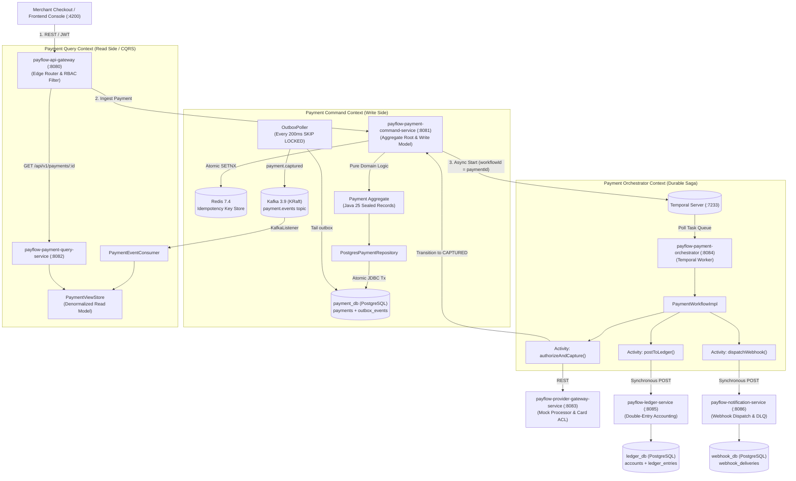

# PayFlow — Distributed Payment Orchestration & Double-Entry Settlement Platform

[-ED8B00?logo=openjdk&logoColor=white)](https://openjdk.org/projects/jdk/25/)
[](https://spring.io/projects/spring-boot)
[](https://temporal.io/)
[-231F20?logo=apachekafka&logoColor=white)](https://kafka.apache.org/)
[](https://www.postgresql.org/)
[](https://redis.io/)
[](https://www.docker.com/)
[](https://www.archunit.org/)

A production-grade, reference payment-processing and settlement engine — modeled after the core architecture of **Stripe** and **Adyen**. 

PayFlow handles the complete payment lifecycle: **idempotent charge ingestion $\rightarrow$ card network authorization $\rightarrow$ double-entry ledger settlement $\rightarrow$ scheduled merchant payouts $\rightarrow$ resilient webhook notification**. It is built from the ground up using **Domain-Driven Design (DDD)**, **CQRS**, **distributed Temporal sagas**, **Transactional Outbox**, and **Java 25 Virtual Threads**.

---

## 1. System Architecture

PayFlow is designed with a **microservices topology featuring strict database-per-service isolation**, an asynchronous event-streaming backbone, and a centralized durable execution engine for sagas.



---

## 2. Core Architectural Invariants

### 1. Orchestrated Saga via Temporal (vs. Choreography)
The payment lifecycle (`authorizeAndCapture → postToLedger → dispatchWebhook`) is managed as a **durable, deterministic Temporal Workflow**, replacing error-prone Kafka-choreographed event loops ("distributed pinball").
* **Automated Compensating Transactions:** If the ledger posting fails, Temporal triggers compensation activities (`reverseProviderCharge` to void the processor authorization and `markPaymentFailed` on the payment aggregate).
* **Built-in Resiliency:** Transient network failures trigger exponential activity retries, while business declines fail immediately.
* **Audit Trail (BR-14):** Every activity attempt, retry, and input/output is recorded in Temporal’s event history and queryable via the **Temporal Web UI** (`http://localhost:8088`).

### 2. Transactional Outbox (Zero Dual-Write Anomalies)
Application code never publishes directly to Kafka. Domain state mutations (`payments`) and domain events (`outbox_events`) are committed in **one atomic ACID PostgreSQL transaction**. A scheduled background poller queries unpublished records using `SELECT ... FOR UPDATE SKIP LOCKED` and publishes to Kafka synchronously (`.get()`) before marking `published_at = now()`. This eliminates ghost events and lost updates.

### 3. Balanced Double-Entry Bookkeeping Ledger
Money is never stored as floating-point numbers; it is handled in minor units (`long amountMinor`, cents) via a immutable `Money` Value Object.
* **Balanced by Construction:** Every capture posts two balanced ledger entry pairs in a single database transaction:
  * **Debit:** `Platform Bank` (Asset) = `+$214.00`
  * **Credit:** `Merchant Payable` (Liability) = `+$207.79`
  * **Credit:** `Platform Fee Revenue` (Revenue) = `+$6.21` (2.9% fee)
* **Reconciliation Engine:** A dedicated integrity endpoint (`GET /operator/ledger/integrity`) computes $\sum \text{Debits} - \sum \text{Credits} = 0$ across the entire ledger platform in real time.

### 4. Hexagonal Domain Purity & DDD
The domain model (`common-cqrs` and `*.domain` packages) contains **zero framework annotations**—no JPA (`@Entity`), no Spring (`@Component`), and no Jackson/Kafka imports.
* **ArchUnit Verification:** Architectural rules are mechanically enforced in CI. If any domain class depends on external libraries or frameworks, the build fails.
* **Event-Driven State Changes:** Aggregates possess no public setters; state changes exclusively via `raise()` and `apply()` using Java 25 pattern matching over sealed event records.

### 5. Distributed Idempotency (BR-2)
Mutating requests carry an `Idempotency-Key` header. An in-memory command bus interceptor acquires an atomic lock in Redis via `SETNX` (`setIfAbsent`) with an `IN_PROGRESS` sentinel and 24-hour TTL:
* Concurrent duplicates fail fast.
* Completed retries deserialize and return the cached response in **$< 15\text{ms}$** without re-executing business logic.

### 6. High-Concurrency Java 25 Virtual Threads
All services enable **Virtual Threads** (`spring.threads.virtual.enabled: true`). Blocking I/O operations (JDBC, outbound REST calls in Temporal activities, and Kafka client commits) unmount from OS carrier threads, providing reactive-scale throughput with standard imperative code.

---

## 3. Service Topology & Port Matrix

| Service | Port | Database | Primary Responsibility |
|---|---|---|---|
| **`payflow-api-gateway`** | `8080` | — | Reverse proxy, JWT RBAC (`ROLE_MERCHANT`, `ROLE_OPERATOR`), path routing |
| **`payflow-payment-command-service`** | `8081` | `payment_db` | Payment aggregate write path, Redis idempotency interceptor, Transactional Outbox |
| **`payflow-payment-query-service`** | `8082` | In-memory / cache | CQRS denormalized read model, Kafka event projection (`payment.*`) |
| **`payflow-provider-gateway-service`** | `8083` | — | Anti-corruption layer (ACL) to mock payment processors with deterministic card rules |
| **`payflow-payment-orchestrator`** | `8084` | — | Temporal Worker hosting `PaymentWorkflow` and activity implementations |
| **`payflow-ledger-service`** | `8085` | `ledger_db` | Double-entry accounting, account charts, 2-phase payouts, and platform integrity checks |
| **`payflow-notification-service`** | `8086` | `webhook_db` | Webhook delivery engine, exponential backoff retries, DLQ management |
| **`frontend` (Angular Console)** | `4200` | — | Merchant Console & Platform Operator Console UI |

### Supporting Infrastructure (Docker Compose)

| Infrastructure | Host Port | Internal Port | Description |
|---|---|---|---|
| **PostgreSQL 16** | `5432` | `5432` | Houses 3 logical databases: `payment_db`, `ledger_db`, `webhook_db` |
| **Redis 7.4** | `6379` | `6379` | Distributed idempotency keys & transient lock coordination |
| **Apache Kafka 3.9** | `9092` | `9092` | KRaft mode (no ZooKeeper) event streaming backbone (`payment.events`) |
| **Temporal Server** | `7233` | `7233` | Durable workflow orchestration engine |
| **Temporal Web UI** | `8088` | `8080` | Real-time workflow visualization, history, and saga audit feed |

---

## 4. Quickstart: Clone, Run & Test

### Prerequisites
* **Java 25 (LTS)** installed (recommended via SDKMAN: `sdk install java 25.0.1-open`)
* **Docker & Docker Compose**
* Standard CLI utilities: `curl`, `jq`, `psql` (optional: `temporal` CLI, Node.js 20+ for Angular UI)

---

### Step 1: Clone the Repository
```bash
git clone https://github.com/your-username/payflow.git
cd payflow
```

---

### Step 2: Start Infrastructure
Spin up PostgreSQL (auto-initializing all three databases), Redis, Kafka in KRaft mode, and Temporal:
```bash
docker compose up -d

# Verify all containers report healthy
docker compose ps
```

---

### Step 3: Run the Test Suite
Run all unit tests, integration tests, and ArchUnit architecture tests across all modules:
```bash
./gradlew test
```

---

### Step 4: Run the Microservices
In local development, boot each service in its own terminal (or configure run profiles in your IDE):

```bash
# Terminal 1: API Gateway
./gradlew :payflow-api-gateway:bootRun

# Terminal 2: Payment Command Service
./gradlew :payflow-payment-command-service:bootRun

# Terminal 3: Payment Query Service
./gradlew :payflow-payment-query-service:bootRun

# Terminal 4: Provider Gateway
./gradlew :payflow-provider-gateway-service:bootRun

# Terminal 5: Payment Orchestrator (Temporal Worker)
./gradlew :payflow-payment-orchestrator:bootRun

# Terminal 6: Ledger Service
./gradlew :payflow-ledger-service:bootRun

# Terminal 7: Notification Service
./gradlew :payflow-notification-service:bootRun
```

*(All services expose an `/actuator/health` endpoint returning `{"status":"UP"}` once booted).*

---

### Step 5: Run Automated End-to-End Verifications
Automated shell test suites validate the system end-to-end against live infrastructure:

```bash
# 1. Verify The Golden Path (Charge -> Outbox -> Temporal Saga -> Ledger -> Webhook)
./scripts/verify-milestone-1.sh

# 2. Verify Resiliency & Failure Flows (Card declines, timeouts, saga rollbacks)
./scripts/verify-milestone-2.sh

# 3. Verify Payout & Refund Lifecycles (2-phase payouts, reversing ledger entries)
./scripts/verify-milestone-3.sh

# 4. Verify Security, RBAC & Observability (JWT tokens, role gates, saga feeds)
./scripts/verify-milestone-4.sh
```

---

## 5. Manual Walkthrough (CLI / cURL)

### 1. Ingest a Payment (The Golden Path)
Send a payment request with a unique idempotency key using the test card ending in `4242`:

```bash
PAYMENT_RESPONSE=$(curl -s -X POST http://localhost:8080/api/v1/payments \
  -H "Idempotency-Key: demo-key-$(date +%s)" \
  -H "Content-Type: application/json" \
  -d '{
    "merchantId": "11111111-1111-1111-1111-111111111111",
    "customerName": "Elena Marsh",
    "amountMinor": 21400,
    "currency": "USD",
    "cardNumber": "4242424242424242"
  }')

echo "$PAYMENT_RESPONSE"
# Returns: {"paymentId":"<UUID>"} (HTTP 201 Created in <15ms)
```

### 2. Poll the Query Read Model (CQRS)
Verify that the payment has transitioned to `CAPTURED` after the Temporal saga completes:
```bash
PAYMENT_ID=$(echo "$PAYMENT_RESPONSE" | jq -r .paymentId)
curl -s http://localhost:8080/api/v1/payments/$PAYMENT_ID | jq .
# Status: "CAPTURED", providerRef: "mock-ch-..."
```

### 3. Verify Double-Entry Ledger Balances
Check that the funds were split and credited accurately (2.9% fee = \$6.21):
```bash
# Platform Bank (Asset): +21400
curl -s http://localhost:8085/accounts/platform-bank/balance | jq .balanceMinor

# Merchant Payable (Liability): +20779 ($214.00 - $6.21 fee)
curl -s http://localhost:8085/accounts/merchant-payable/balance | jq .balanceMinor
```

### 4. Inspect the Temporal Web UI
Open **[http://localhost:8088](http://localhost:8088)** in your browser:
* Find the workflow execution with ID matching `PAYMENT_ID`.
* View the visual execution timeline: `authorizeAndCapture` $\rightarrow$ `postToLedger` $\rightarrow$ `dispatchWebhook`.
* Inspect activity inputs, outputs, timestamps, and retry counts.

---

## 6. Deterministic Mock Card Test Matrix

The provider gateway simulates processor behavior using the **last 4 digits of the card number**:

| Card (Last 4) | Simulated Outcome | Expected System Behavior |
|---|---|---|
| `4242` | **Approved** | Golden path: captured, settled to ledger, webhook delivered. |
| `0002` | **Declined: Insufficient Funds** | Fails fast, non-retryable failure, no ledger entries posted. |
| `0069` | **Declined: Card Expired** | Fails fast, payment marked `FAILED`. |
| `0119` | **Processor Timeout (5s drop)** | Simulates downstream network outage; exercises Temporal activity retries. |
| `0127` | **Declined: Do Not Honor** | Generic card decline path. |

---

## 7. Frontend Console (Optional)

PayFlow includes an Angular-based Console UI with role-separated views for Merchants and Platform Operators:

```bash
cd frontend
npm install
npm start
# Navigate to http://localhost:4200
```

* **Merchant View:** Transaction history, live payment drilldowns, account ledger balance, API keys, and webhook delivery logs.
* **Operator View:** Real-time platform-wide ledger integrity check ($\sum \text{Debits} - \sum \text{Credits}$), mock provider routing toggles, and live saga execution feeds.

---

## 8. Repository Layout

```
payflow/
├── common-cqrs/                    # Framework-agnostic DDD/CQRS harness (AggregateRoot, CommandBus)
├── payflow-common/                 # Shared domain value objects (Money, Currency) and event DTOs
├── payflow-api-gateway/            # Port 8080: Edge router & JWT authentication filter
├── payflow-payment-command-service/# Port 8081: Write model, Transactional Outbox, Redis Idempotency
├── payflow-payment-query-service/  # Port 8082: CQRS read model projecting Kafka events
├── payflow-provider-gateway-service/# Port 8083: Anti-corruption layer & deterministic card simulator
├── payflow-payment-orchestrator/   # Port 8084: Temporal Worker hosting PaymentWorkflow
├── payflow-ledger-service/         # Port 8085: Double-entry accounting engine & payout lifecycle
├── payflow-notification-service/   # Port 8086: Webhook delivery engine with retry schedule & DLQ
├── frontend/                       # Port 4200: Angular 22 Merchant & Operator Console
├── infra/postgres-init/            # Multi-database bootstrap scripts for PostgreSQL
├── scripts/                        # Automated end-to-end verification suites
└── docker-compose.yml              # Local infrastructure orchestration
```

---

## 9. Engineering Standards

Every contribution in this repository complies with the rules defined in [`AGENT_AND_DEV_GUIDELINES.md`](./AGENT_AND_DEV_GUIDELINES.md):
1. **Domain Purity:** Domain entities and value objects never import framework annotations.
2. **Bus-Only Writes:** Controllers never speak directly to repositories; all mutations pass through `CommandBus.dispatch()`.
3. **Dual-Write Prevention:** No direct Kafka publishing from HTTP request threads; all events route through the Transactional Outbox.
4. **Financial Concurrency:** Every mutating request validates an idempotency key and enforces optimistic locking (`version`).
5. **Modern Java 25:** Sealed hierarchies, switch pattern matching, immutable records, and virtual threads used throughout.
